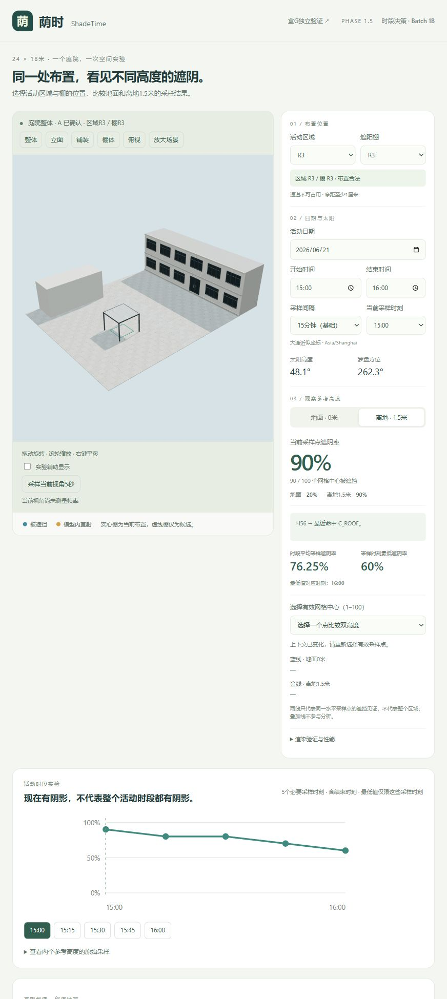
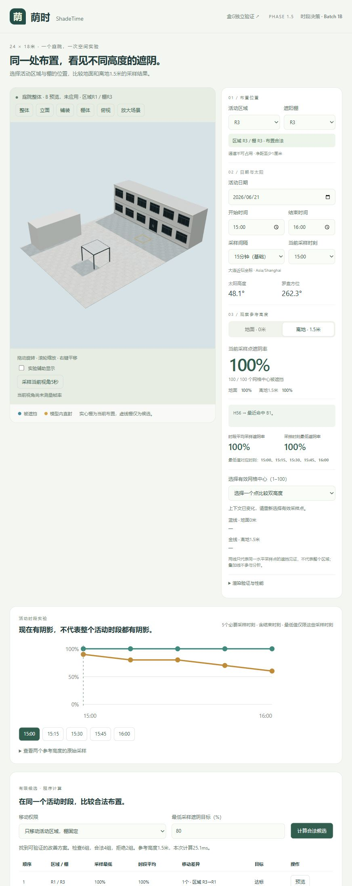
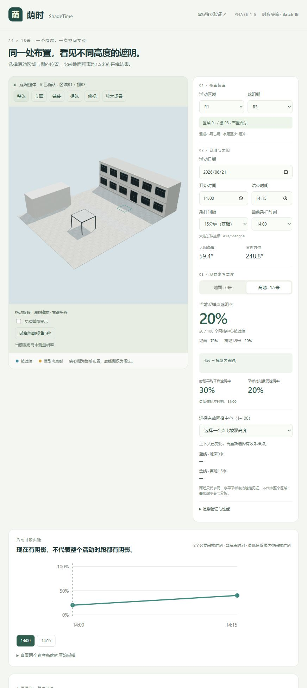

# ShadeTime Phase 1.5 · Batch 1B 验收报告

日期：2026-11-16（Asia/Shanghai）。真实工程：`D:\ShadeTime`。

**裁决：GO WITH CONDITIONS。** 时段分析、有限合法候选、A/B预览确认、单点双高度证据与版本门禁已实际实现、测试并在浏览器运行。原65项保留，新增28项，共93 PASS、0 FAIL、0 SKIP、0 CANCELLED。非阻断条件：最重候选案例211.4ms略超200ms目标；跨设备、长时性能及GPU时间未测。没有接入AI，也不将此批描述为完整产品或竞赛最终交付。

## 1. 真实基线与保护范围

- Batch 1A基线：`003b7a38a69271dfab65bd82aef3bf2b47551011`。启动时工作区干净，四笔Batch 1A提交及七笔阶段1历史保留。
- 当前开发分支：`feature/phase1.5-batch1b-decision`；Batch 1A原分支仍指向003b7a3。
- 最终代码检查点：`02a5ac87df3540a70577aeca20998bb7986e3a60`。文档、截图与最终审计归档追加在其后；最终归档HEAD与干净状态在聊天交付中报告，也可用本报告的最近Git提交查得，避免文档自引用自身SHA。
- 本地main与本地origin/main引用均为`7bf34be2fc86592e9283d1a7c5c0962e2d42607f`。本批未推送/合并，收尾未fetch，不能据本地origin引用宣称当前远程重新核验完成。
- Node实测v24.22.1，Three 0.160.0、SunCalc 1.9.0；声明、lockfile与已安装包一致。未安装依赖、读取.env或调用真实AI API。
- `final-audit.json`检查的38个冻结路径无差异：所有旧测试、太阳/射线/盒G、原业务场景/净距/布局/单时刻分析、Batch 1A视觉/投影模块、原页面与依赖文件。未改变100点、0/1.5米、TD004、坐标或合法布局规则。

## 2. 实际完成的交付

| 模块/文件 | 已实现职责 |
| --- | --- |
| `src/domain/period.js` | 规范同日时段，生成含结束点的采样序列，逐时调用原analyzeCourtyard，按实际间隔做梯形积分，独立汇总双高度 |
| `src/domain/candidates.js` | 白名单ID候选、移动权限和最低目标、合法性过滤、未舍入排序、严格同条件A/B比较 |
| `src/domain/decision-session.js` | 不可变布局/约束快照、单调场景/分析/观察版本、请求ID、当前候选白名单、过期拒绝及确认前重算 |
| `src/domain/point-evidence.js` | 从当前真实样本提取同一水平点的两高度射线、命中对象/交点、证据引用及上下文核验 |
| `src/view/period-panel.js` | 真实时间横轴SVG曲线、采样按钮、双高度原始表格、平均/最低及全部并列最低时刻，无效采样显示缺口 |
| `src/view/candidate-panel.js` | 候选表格、移动对象差异、目标状态、A/B切换、预览与确认按钮 |
| `src/view/point-evidence.js` | 不投影、不参与计算的两条射线和命中点，正确释放自有资源 |
| `src/courtyard.js` | 表单、分析会话、当前采样与场景联动、A/B预览确认、失效清理、原诊断/相机接线 |
| `public/courtyard.html`、`public/courtyard.css` | 沿用原设计语言增加时段、曲线、比较和证据面板；明确当前显示A还是未应用B |
| `server/app.js` | 仅增显式静态资源白名单，原服务/AI诊断边界保留，无新AI业务接口 |
| `test/period.test.js`、`period-panel.test.js`、`candidates.test.js`、`point-evidence.test.js`、`decision-session.test.js` | 新增28项实逻辑测试 |
| README、路线、决策TD011、开发日志、Prompt索引、实施清单、本报告及证据 | 更新当前状态、运行方法、真实问题与已知边界 |

没有新增视觉遮挡物，也没有改动Batch 1A的建筑/铺装/棚体样板。活动区域彩色边界与双射线只是辅助显示。

## 3. 时间与指标语义

沿用冻结的Asia/Shanghai、大连近似经纬度、同日15–120分钟和5分钟输入步长。15分钟为基础采样，允许显式5/10/30分钟对照；最后一个时刻一定包含，支持不足一个间隔的末段。跨午夜、非法日期、错时区及无效步长拒绝。UTC日期可与本地日期不同，主机系统时区不影响结果。

每时刻保留显式UTC时间戳、当地时刻、太阳高度、罗盘方位、两高度有效点数、分析状态及原始100点/命中证据。每个参考面固定分母100。平均值为各相邻时刻梯形面积除以完整时长；最低值仅指采样时刻最低，保留并列时刻。任一必要采样无效或不足100个有效点则整段N/A，不删除点、不缩短时长。

2026-06-21，R3区域/R3棚，15:00–16:00、15分钟间隔的**真实运行结果**：

| 大连时刻 | 地面0米 | 离地1.5米 |
| --- | ---: | ---: |
| 15:00 | 20% | 90% |
| 15:15 | 10% | 80% |
| 15:30 | 0% | 80% |
| 15:45 | 0% | 70% |
| 16:00 | 0% | 60% |
| 时段梯形平均 | 5% | 76.25% |
| 采样最低 | 0% | 60% |
| 最低时刻 | 15:30、15:45、16:00 | 16:00 |

用户指定的90/80/80/70/60测试独立验证76.25%/60%/16:00；当前场景恰好也计算出这组值。生产模块没有硬编码这些比例。15:00–15:20的末段实际按5分钟加权；04:45–05:30含无效必要采样时保留四个时刻并使整段N/A。

## 4. 候选、A/B与用户确认

默认上述时段、1.5米、只移区域、最低目标80%：6组合中4合法、2通道拒绝。R1/R3与R4/R3的采样最低/平均均100%；原R3/R3为60%/76.25%；R6/R3为0%/0%。这些是有限候选下的实算，不是AI推荐或全空间最优证明。

两者可移时检查24组、16合法、8拒绝；只移棚时区域保持不变。固定建筑不能移动。排序依次为未舍入最低、未舍入平均、移动对象更少、固定ID。表格列出移动对象数量及ID变化。

A/B必须同高度、日期时段、间隔、时区/地点与场景/算法/采样版本。B预览只改变显示和辅助边界，正式selection仍是A；切A或拒绝恢复。确认前重新计算，达标才应用；不达标可查看但不能确认成达标方案。条件变化使旧候选和预览失效，非法输入时旧B标签/边界一并清理。

场景版本用于业务条件快照，几何版本另为courtyard-v1。analysisVersion每次接受分析递增；相机/当前时刻改变观察contextVersion，不改变数值分析版本。请求序号、用途、版本、候选白名单和应用前重算已测试；未来模型只能引用当前候选ID，不能提交任意坐标。**服务端AI协议和不可信客户端防护仍属于下一轮工作**，本批客户端门禁不等于已实现AI安全闭环。

## 5. 双高度空间证据

真实浏览器与Node：R1区域/R3棚，2026-06-21 14:00，P56水平坐标(-4.9,-1.9)m：

- 地面原点(-4.9,0,-1.9)，最近命中B1，交点约(-8,5.626950,-0.698488)m。
- 离地1.5米原点(-4.9,1.5,-1.9)，未命中七个实体，模型内直射。

两者共享原太阳单位向量；证据直接提取单时刻计算，并绑定布局、时刻、分析ID和观察版本。改变采样、布局、分析、参考高度或相机均清除旧证据；真实Orbit拖动也已验证。单点命中不夸大为整个区域的因果解释。

## 6. 自动化、浏览器与交叉核验

最终执行：

```powershell
node --test --test-reporter=spec --test-reporter-destination=docs/evidence/batch1b/all-tests.spec.txt --test-reporter=tap --test-reporter-destination=docs/evidence/batch1b/all-tests.tap
```

| 范围 | PASS | FAIL | SKIP | CANCELLED |
| --- | ---: | ---: | ---: | ---: |
| 原Batch 1A基线 | 65 | 0 | 0 | 0 |
| 新增：时段10、面板2、候选6、证据3、会话7 | 28 | 0 | 0 | 0 |
| 最终总计 | **93** | **0** | **0** | **0** |

最终运行3088.7553ms；这是Node测试耗时，不是浏览器FPS。

覆盖含结束点、非均匀末段、5/10/15/30间隔、0/100%与并列最低、无效必要点、双高度独立、梯形76.25%与62.5%、非法/闰日/跨UTC日期及不同主机TZ、单时刻逐点复用、权限与合法布局、未舍入排序、错条件拒绝、点证据过期、A→B→A、逆序/伪造请求和确认前重算。全部旧测试未删除或改断言。

独立代码审查找到三项UI问题，均在真实浏览器先复现再修复：相机变化保留旧证据；非法时段留下旧B标签/边界；修正约束不恢复当前表单的分析。`review-red.json`保留三项失败，`review-green-final.json`三项PASS；`orbit-check.json`真实拖拽PASS。README旧状态也已更新。

补测直接填值返回数字框原值时未触发change，仍显示N/A；原观察保存在`final-ui-recheck.json`。真实键盘提交非法值、换日期、重新输入80后恢复最新日期2026-06-23的分析。没有用放宽断言或修改数学迁就填值行为。

归档核对：30个浏览器时段状态、150个采样时刻、136条候选指标、9份有完整约束快照的排序列表，均与Node重算一致，比较容差1e-12。当前显示的B单时刻指标另核对，未把诊断中A的period误当B。早期记录缺少会话约束，不猜造权限，只核对其中已有的指标。

复核命令（项目根目录）：`node docs/evidence/batch1b/verify-evidence.mjs`。原始结论`final-audit.json`；该脚本只输出新的核对结果，不覆盖归档。

## 7. 真实性能与限制

设备为本机Windows、NVIDIA GeForce RTX 5060 Laptop GPU，ANGLE D3D11，32逻辑核。浏览器为Codex内嵌Chromium，UA Chrome/157.0.0.0；浏览器报告deviceMemory=16GiB是API值，不能据此推断物理内存。5秒采样全程visible/focused，整体视角画布831×653 CSS像素、DPR1.5、绘制1246×979，屏幕1707×1067 CSS像素。

| 同批实际状态 | FPS | RAF P95 | Draw Calls | Triangles | >250ms停顿 |
| --- | ---: | ---: | ---: | ---: | ---: |
| 候选计算前 | 169.03 | 6.10ms | 28 | 17546 | 0 |
| 24组合计算完成后 | 167.74 | 6.10ms | 28 | 17546 | 0 |
| 双高度证据显示 | 167.56 | 6.20ms | 32 | 17746 | 0 |
| 终审修复后默认状态 | 167.45 | 6.20ms | 28 | 17546 | 0 |

CPU提交P95为0.5–0.6ms，不是GPU耗时。前三项是同批浏览器条件对照；双高度示例的日期时段/布局不同，不能当成单变量GPU实验。Batch 1A历史240FPS与本批视口/浏览器条件不同，不据此判定回归或加速；旧低帧异常仍保留在Batch 1A报告中。

默认1小时/15分钟间隔：终审后24组比较68.4ms；另一轮75.7ms。最长2小时/5分钟间隔共25时刻：时段17.0ms、24组比较211.4ms，**FAIL于≤200ms性能目标**。此计算同步占用主线程，可出现短暂交互停顿；当前有限候选和显式按钮范围内列为非阻断条件，不减少100点/实体/采样精度。后续如需密采样频繁交互，应先考虑分块或Worker，而不是降低正确性。

GPU时间、VRAM、跨设备/手机、长时间稳定性、独立Edge本批全流程性能、CPU节流场景：**NOT RUN**。没有宣称跨设备帧率保证。

## 8. 证据与实际截图

所有本批证据位于`docs/evidence/batch1b/`，均纳入版本管理：

- `period/panel/candidates/evidence/session`各阶段的`*-red.spec.txt`、`*-green.spec.txt`。
- `stage2/3/4/5-browser.json`：阶段门槛通过后才进入下一项的实际记录。
- `all-tests-before-review.*`、`all-tests.*`：终审前及修复后完整spec/TAP。
- `final-browser.json`：完整浏览器诊断、候选计时、FPS/资源/加载记录；本批收集的warn/error为空。
- `review-red.json`、`review-green-initial.json`、`review-green-final.json`、`orbit-check.json`、`invalid-height-before.json`、`final-ui-recheck.json`：失败、修复及实际输入对照，不删失败历史。
- `final-audit.json`与`verify-evidence.mjs`：冻结路径/依赖与浏览器Node交叉核验。
- `images/period-final.jpg`、`comparison-final.jpg`、`dual-evidence-final.jpg`：真实运行页面截图，无生成图片。







## 9. 实际本地提交

| SHA | 内容 |
| --- | --- |
| 55e9d27b8092f54f317151109def3b33d349ffaa | 时段采样、实际间隔梯形与有效性门禁 |
| e7c2e2a1827f622985904ffd9dda765cc926031b | 最小时段UI、曲线与采样场景联动 |
| 50a870891c81604c1d5f0259dae68a559f468d3c | 合法候选、严格同条件A/B与确认预览 |
| 3807edc6c53946410dee13dcf9f4fab0d63409cb | 上下文绑定的双高度单点射线 |
| 6f059f3ee789afaa67ed80c49433296066fe00b2 | 集中版本会话、请求与应用前重算 |
| 02a5ac87df3540a70577aeca20998bb7986e3a60 | 终审三个UI修复、真实RED/GREEN及93项最终证据 |

本报告及最终证据归档另作本地提交。运行`git log --oneline 003b7a3..HEAD`查看完整交付链；`git status --short --branch`核对最终干净状态。未创建空提交、未重置历史、未改全局Git配置、未推送或合并main。已跟踪文件无.env/私人证书，.env仍被忽略；没有读取其内容。此项不是对所有第三方历史或所有秘密格式的绝对保证。

## 10. 未完成事项与停止点

真实AI约束解析/解释/建议闭环、服务端验证协议、保存/恢复/撤销、跨午夜活动、连续时间极值保证、额外视觉景观、B2重建、跨设备性能及竞赛用户测试/视频/PDF：**NOT RUN / 未实现**，其中跨午夜保持冻结范围外。

本批P0计算、P1候选/A/B、P2证据验收通过。以最长密采样超200ms及未进行跨设备性能为明确条件交付；没有P0计算回归或未解决的终审正确性问题。停止在Batch 1B，等待下一轮独立指令。
