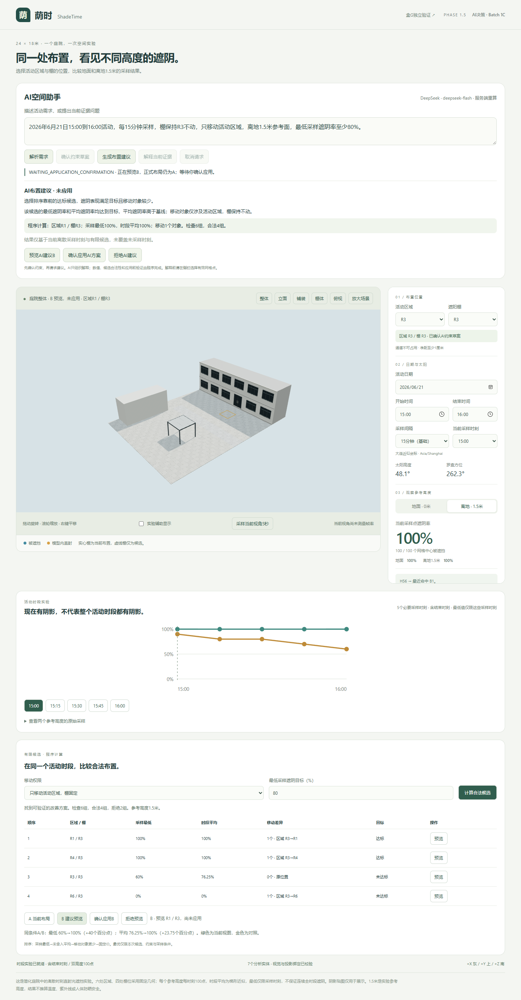
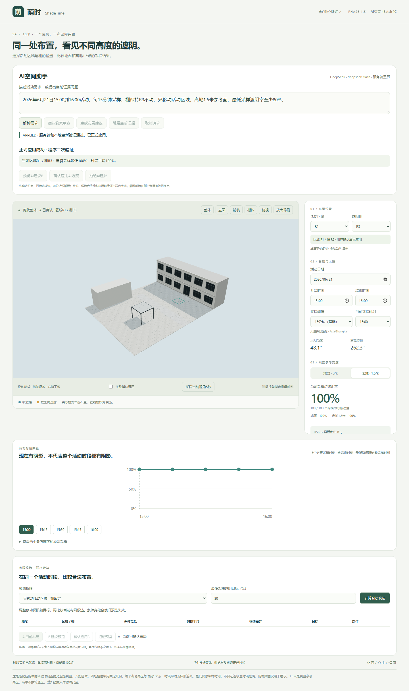
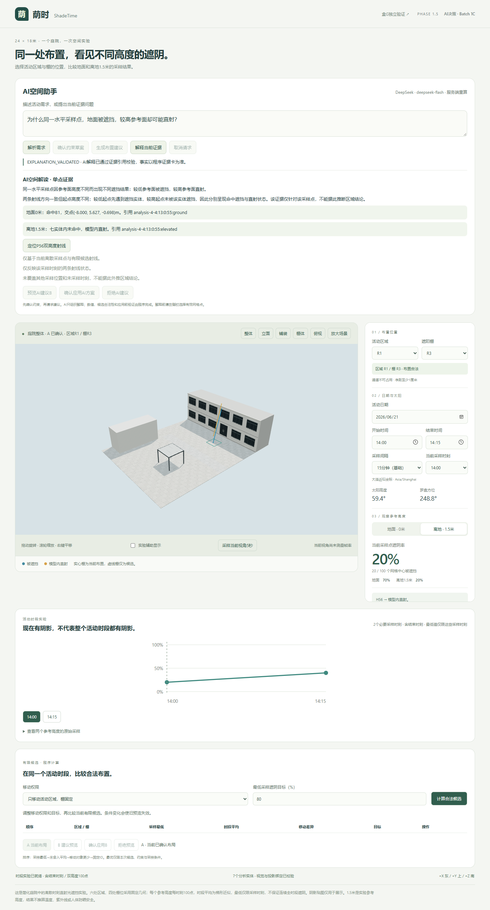

# ShadeTime Phase 1.5 · Batch 1C 验收报告

日期：2026-11-16，Asia/Shanghai。真实目录：`D:\ShadeTime`。运行地址：`http://127.0.0.1:3000/courtyard`。

**裁决：GO WITH CONDITIONS。** 三条真实DeepSeek业务链已打通，包含用户动作确认、有限合法候选、A/B预览、服务器与本地重新计算应用及证据解释。原93项完整保留，新增26项，共119 PASS、0 FAIL、0 SKIP、0 CANCELLED；真实Edge浏览器七组场景全部通过。条件：模型回复可能因严格协议被拒绝，需用户修正/重试；最终浏览器自动化为本机无头Edge，非人工可用性、跨设备或长期性能验收。本轮没有加入保存/撤销或竞赛最终材料，不宣称完成整个产品。

## 1. 基线、实际分支与提交

- 真实启动HEAD为`e891cd1a3ffaea5352de04e8b5f7daeeefb7e794`，Batch 1B分支和工作区干净；93项重新通过后创建`feature/phase1.5-batch1c-ai`。未覆盖已有工作。
- 当前代码提交检查点：`bc9b7a63e50c633333c35b82ed8b3afb86cce3ff`，后续实际记录/说明/CLI验收补丁另行提交，完整最终HEAD在本轮聊天交付与工作目录外的交付JSON记录。仓库报告不伪造自引用自身SHA；运行`git log --oneline e891cd1..HEAD`可核查最终归档链。
- 本地main与本地origin/main引用仍为`7bf34be2fc86592e9283d1a7c5c0962e2d42607f`。未推送、未合并main、未强推/重写历史、未改全局Git配置。未将本地origin引用说成实时远程状态。
- Node v24.22.1；Three 0.160.0、SunCalc 1.9.0、package/lockfile不变，无应用新增依赖。
- 服务端启动加载已有专用环境变量，未输出密钥；Base URL仍为`https://api.deepseek.com`，无`/v1`，模型只用`deepseek-flash`。

| 实际提交SHA | 内容 |
| --- | --- |
| 2e6d4e5048e8b83cc9bc82b17de6eee913da7660 | 固定供应商JSON调用、超时/取消、安全错误与客户端测试 |
| 144f1528bac7798d451e0f9f2da141ff8a0eb1e4 | 服务端权威草案/候选/证据/重算应用，真实API初轮与协议迭代证据 |
| bc9b7a63e50c633333c35b82ed8b3afb86cce3ff | HTTP与前端闭环、失效/恢复修复、首次真实浏览器证据及回归 |

最终说明与证据归档提交追加在上述代码提交后，交付时核对工作区干净。

## 2. 实际修改文件与职责

| 新增/修改 | 职责 |
| --- | --- |
| 新增`server/ai-client.js` | 复用原AI_CONFIG，模型列表检查、固定Completion地址、JSON输出、20秒、取消、脱敏错误；不改原诊断函数 |
| 新增`server/ai-protocol.js` | 请求/模型字段白名单、草案校验、业务枚举、自由文本与事实边界、三链系统提示 |
| 新增`server/ai-service.js` | 随机会话/上下文、版本/序号门禁、需求草案与确认、真实合法候选、证据重建、应用前二次验证 |
| 新增`server/ai-http.js`，修改`server/app.js` | 固定POST接口、同Origin/回环Host、JSON与16KiB上限、客户端取消；只增加前端模块静态白名单 |
| 新增`src/view/ai-workflow.js` | 请求状态、草案确认、异步过期丢弃、预览/确认/拒绝、证据解释、会话过期恢复；无供应商密钥 |
| 新增`src/view/ai-panel.js` | 紧凑AI协作区、清晰状态和程序事实卡，用textContent呈现模型文字 |
| 修改`src/courtyard.js` | 将AI接入既有session/candidates/A/B流程，服务端与本地指标核对；相机只使观察证据失效 |
| 修改`public/courtyard.html`、`public/courtyard.css` | 沿用米白/深绿设计，增加输入、草案、建议、引用和确认按钮；显式两对象固定权限选项 |
| 新增四个`test/ai-*.test.js`业务测试 | 5项客户端、13项服务、1项HTTP集成、7项前端工作流；只替换外部网络，不替换域计算 |
| 新增`scripts/check-ai-business.js` | 显式真实供应商三链业务验收，输出脱敏JSON，不作为普通离线测试自动执行 |
| 新增`scripts/check-ai-browser.mjs` | 使用外置playwright-core及本机Edge，实际按钮操作/真实HTTP/截图/离线故障和RAF计时 |
| README、路线、TD012、日志、Prompt索引、实施清单、本报告与batch1c证据 | 当前状态、重跑命令、边界、实际失败和修复记录 |

旧太阳/射线/100点/双高度/TD004/合法性/时段数学模块及全部原测试均不变。`final-audit.json`核对51个冻结文件无差异。没有新建筑、树木、材质重建、Agent或第二供应商。

## 3. 三条真实AI链与事实来源

### A. 自然语言约束草案 — PASS / LIVE API

真实输入采用页面默认需求：2026-06-21，15:00–16:00，15分钟采样，棚R3固定，只移活动区域，1.5米参考面，最低目标80%。

DeepSeek输出结构化date/startTime/endTime/timeZone/intervalMinutes/height/movementMode/minimumShade/selection/needsClarification/clarificationQuestions/summary。服务器校验冻结同日15–120分钟、5分钟时间步长、采样间隔5/10/15/30、0或1.5米、有限ID及布局合法性。模型不计算遮阴率。

浏览器真实`/api/ai/parse`在最终轮6162.71ms返回SUCCESS，正式selection仍R3/R3；显示“等待确认约束”，只有点击确认草案才应用表单并执行确定性分析。草案确认不会直接应用建议布局。

真实额外输入与结果：

- “参考高度设为2米，保留原值交给程序检查”：VALIDATION_REJECTED（6113.13ms），当前高度仍1.5米。
- “靠近入口，并尽量舒服”：NEEDS_CLARIFICATION（1611.54ms），未支持偏好没有静默忽略，草案不可确认。

用户未指明的年份/参数可以沿用当前值，必须在可见草案中确认；当前并非任意自然语言规则引擎。未知区域、坐标、非法日期和越界参数由严格校验拒绝。

### B. 双高度真实空间证据解释 — PASS / LIVE API

实际R1区域/R3棚，2026-06-21 14:00，P56：

- 地面原点(-4.9,0,-1.9)m，命中B1，交点约(-8,5.626950,-0.698488)m。
- 较高参考原点(-4.9,1.5,-1.9)m，未命中七个分析实体，模型内直射。

服务器从业务参数重新调用原时段/单时刻分析，生成同一水平点的两条射线、对象/交点、analysisId与contextVersion引用；不接受浏览器提交的命中事实。DeepSeek解释4199.39ms返回SUCCESS，返回summary/explanation/pattern/evidenceRefs/limitations；两引用与状态模式严格匹配。

程序事实卡展示数值与命中ID，AI只组织受约束文字。真实浏览器点击“定位P56双高度射线”可将现有证据带入视野，切俯视后旧解释/引用/射线清除。伪造引用、旧分析、旧观察或错误几何版本的自动化测试拒绝通过。单点证据不外推为区域结论。

### C. AI辅助有限布置决策 — PASS / LIVE API

约束经确认后，服务器复用既有enumerateCandidates与inspectLayout，检查6组、4合法、2通道拒绝。R3/R3原1.5米最低60%、平均76.25%；达标候选R1/R3和R4/R3最低/平均均100%。这些数值来自程序计算。

模型只接收当前达标候选白名单和真实指标，只能返回其中的candidateId及理由码/受限文字。最终真实建议6397.26ms，选R1/R3；用户动作预览后正式A仍R3/R3。验收脚本通过真实按钮切A、切B、拒绝，确认恢复A；重新建议5997.96ms，再预览、确认，`/api/ai/apply`23.40ms重算通过后，本地再独立重算核对并用既有session.applyCandidate应用。

最终正式区域R1/棚R3，最低/平均100%。应用确认提示在截图和迟到观察刷新后仍为APPLIED。所有“用户动作”在此指验收脚本点击产品按钮，**不虚构项目负责人已亲手接受某条建议**。

另以“区域与棚都不能移动、目标仍80%”真实解析确认，程序返回NO_FEASIBLE_CANDIDATE（11.92ms），目标未降，未向模型请求伪造可行建议。none只是两个既有可动布尔值均false，不改变空间合法性。

## 4. 服务端权威与安全检查

接口为`/api/ai/context`、`invalidate`、`parse`、`confirm-draft`、`recommend`、`explain`、`apply`、`reject`。仅回环Host/同Origin JSON POST，16KiB限制，无开放CORS。未知字段、客户端比例/交点/坐标、伪造候选/几何版本被拒绝。静态白名单不提供.env、server源码或密钥。

服务端保存随机sessionId/contextId、当前规范快照、单调revision/requestId、当前草案/审批/候选令牌。客户端版本只是待核查的上下文信息；业务设置改变却没有递增场景/分析版本会拒绝，事实始终重新计算。新解析撤销旧草案及审批，旧/逆序请求不复活；20分钟TTL，最多64会话，重启或过期需重新请求和确认。

AI返回JSON视为不可信。草案不合法不入审批；建议ID不在当前达标白名单或理由码与事实不符拒绝；应用须明确confirmed且令牌仍属于当前业务/分析状态，再重算最低目标。证据由服务器重建并核对两引用/模式，模型不得新增数值字段。AI自由文字禁止数字、中文数值带单位、百分比/交点及全域保证，几何事实由程序卡片显示。**自然语言的所有语义并非形式化证明**，仍需以事实卡、受限模式和有限范围理解解释，不能将模型文字当作新的计算依据。

API Key只由服务端Node环境使用；普通测试均无真实密钥，客户端缺密钥时零请求。模型缺失、401、超时/取消、非JSON和不合规字段均有测试；不切换模型/供应商。审计未读取.env内容；新增文本扫描未发现常见真实密钥格式，Git未跟踪敏感路径，.env仍被忽略。该扫描不是所有秘密形式或公网安全模型的绝对证明。本工具仍为本机实验室，未加入账户/公网部署。

## 5. 自动化与浏览器验收

最终命令：

```powershell
node --test --test-reporter=spec --test-reporter-destination=docs/evidence/batch1c/all-tests.spec.txt --test-reporter=tap --test-reporter-destination=docs/evidence/batch1c/all-tests.tap
```

| 范围 | PASS | FAIL | SKIP | CANCELLED |
| --- | ---: | ---: | ---: | ---: |
| 原Batch 1B冻结基线 | 93 | 0 | 0 | 0 |
| 新增：客户端5、服务13、HTTP1、工作流7 | 26 | 0 | 0 | 0 |
| 合计 | **119** | **0** | **0** | **0** |

最终4062.5164ms，仅为Node测试耗时。Mock只替换供应商传输，真实规范化、合法性、太阳/射线、候选和确认重算均执行；不是将Mock响应当真实AI演示。

覆盖缺密钥零请求、固定模型/无替换、鉴权错误脱敏、20秒生产配置与测试短超时、外部取消、空/错JSON/未知字段、非法日期/时间/高度/权限、未确认场景不变、旧草案撤销、伪造坐标/比例/候选ID、未达标拒绝、无可行目标不降低、旧证据/版本/逆序/在途失效、确认前重算、预览拒绝恢复、离线不损手动、过期会话恢复、应用确认不被观察刷新误清等。

最终实际浏览器`browser-final.json`为安装的Microsoft Edge 157.0.4341.60，playwright-core 1.65.1外置工具，headless=true，真实WebGL/NVIDIA GPU；无模拟成功层或静态动画。七场景全部PASS：

1. 真实解析→确认→建议→A/B→拒绝→重荐→确认重算应用。
2. 真实双高度解释→定位→切视角失效。
3. 未支持条件真实澄清。
4. 非法高度真实拒绝。
5. 无可行候选保持目标。
6. 浏览器真实离线后AI_UNAVAILABLE，手动候选仍4合法、原时段最低60%。
7. 取消请求，正式selection不变。

最终pageErrors为0。console保留预期的422拒绝与ERR_INTERNET_DISCONNECTED两条，不声称控制台完全无错误。原CUA工具中断不可用后才使用外置Playwright；未加入应用依赖或下载新浏览器。最终可视前台人工演示/用户测试并未因此完成。

## 6. 真实问题、失败与修复

- 初轮需求解析/非法数值拒绝/证据解释成功，建议文字含协议禁词，澄清selection为内部null对象，均拒绝。`ai-live-initial.json`保留真实回复。明确提示后建议/应用/解释/澄清通过；第二轮非法输入输出不合规仍拒绝，保留`ai-live-protocol-recheck.json`，不重写FAIL为PASS。
- 服务测试第一次错误把混有假ID的一组引用归为旧证据；修正分类并重测，保留service-green-attempt失败。
- 新需求解析后旧草案还能确认：先写draft-revocation RED，清空草案/审批/建议能力并检查最新返回序号后GREEN。
- 中文“八成/五十度”仍可能绕过数值文字门禁：先RED，再补单位数字校验，不接纳模型数值作为事实。
- 服务重启后前端旧session不能恢复：先RED，遇STALE清令牌，下一次重新解析建新会话，绝不自动重用旧应用。
- 初轮浏览器即时应用断言PASS，但截图显示迟到观察把APPLIED覆盖为STALE：保留初轮截图，补application-ack RED，修复只在同业务基线保留应用事实卡。最终浏览器截图后再过两帧仍APPLIED。
- 验收器一度等待隐藏JSON脚本“可见”导致超时，修正为等待内容；未改应用标准。原生控制通道无法恢复，改外置测试工具并如实标注最终运行环境。
- 失败测试输出中的原生空格原样保存，故这些历史证据有git whitespace警告；源码/文档不据此改写原始失败输出。

## 7. 性能与实际限制

本机Windows，NVIDIA GeForce RTX 5060 Laptop GPU、ANGLE D3D11、32逻辑核。浏览器deviceMemory报告16GiB，不推断物理总内存。最终Edge无头测试：viewport1440×1000、DPR1，庭院canvas1006×560；5秒窗口visibility/focus均true。

| 同批整体视角稳态样本 | FPS | RAF P95 | Draw Calls | Triangles | >250ms停顿 |
| --- | ---: | ---: | ---: | ---: | ---: |
| AI流程前 | 238.59 | 4.30ms | 28 | 17546 | 0 |
| 完成AI验收后重载默认页 | 239.99 | 4.30ms | 28 | 17546 | 0 |

CPU提交P95 0.6/0.5ms，不是GPU时间。前后重载页面的稳态样本不能证明长时无泄漏或AI在途帧率；与Batch 1B前台167–169FPS的视口/浏览器条件不同，不能宣称提速。模型等待约1.6–6.4秒（最终业务样本），20秒统一超时；应用重算HTTP当次23.4ms。数值为实测样本，不是SLA。

原Batch 1B最长密采样候选211.4ms超200ms目标仍为已知限制，本轮未做无关性能重构或降低精度。GPU时间/VRAM、跨设备/手机、长时间稳定性、最终全流程前台人工性能：NOT RUN。

## 8. 原始证据与运行复现

`docs/evidence/batch1c/`包含：

- `DEVELOPMENT_PROMPT.md`：本轮完整用户指令格式化转录；原生完整会话导出尚未生成，不伪造字节来源。
- `baseline-93.spec.txt`：启动真实93项；`client/service/http/workflow`等RED/GREEN及后续修复记录；`all-tests.spec.txt`和`all-tests.tap`：最终119项。
- `ai-live-initial.json`、`ai-live-protocol-recheck.json`：真实API解析JSON、实际输入、时间、请求ID与原始失败，均不含授权头。
- `ai-live-final.json`：当前协议下独立CLI真实业务最终PASS；正常解析4191.65ms、建议7120.50ms、应用重算8.99ms、非法高度VALIDATION_REJECTED、未支持条件NEEDS_CLARIFICATION、证据解释SUCCESS。它与浏览器实测分别记录，不混用请求耗时。
- `browser-initial.json`、`browser-final.json`：真实HTTP输入/响应/请求ID、状态快照、性能、错误与截图索引。会话ID是短时本机测试能力，归档时需先重启服务使其失效。
- `browser-final-draft/preview/applied/evidence/clarification/invalid/no-feasible/offline/final-page.png`：真实浏览器截图；对应initial保留，包括旧状态问题。
- `final-audit.json`：51冻结路径、原测试、真实链状态与敏感路径/新增文本扫描。

启动：

```powershell
Set-Location -LiteralPath 'D:\ShadeTime'
git switch feature/phase1.5-batch1c-ai
node --test --test-reporter=spec
node --env-file-if-exists=.env server/index.js
```

3000若已由本项目监听，直接打开页面，不启动第二实例。手动分析无密钥仍可用；真实AI需本机已有环境变量。服务仅监听127.0.0.1。

显式真实API业务验收：`node --env-file-if-exists=.env scripts/check-ai-business.js <新的输出JSON路径>`，会产生实际供应商请求。浏览器复核：`node scripts/check-ai-browser.mjs <已有playwright-core/index.mjs绝对路径> <新的输出JSON路径>`；外置工具不属于npm ci应用依赖。不要覆盖已有历史证据。







## 9. 未完成与下一步竞赛提交

本轮已实现三条真实AI链及其必要失败路径，停在Batch 1C。尚未完成：保存/恢复/撤销、云端/账户、前台人工可用性测试、广泛自然语言样本与长时稳定性、完整原生对话导出/录像、最终参赛视频/PDF、平台提交；均NOT RUN，不把验收脚本按钮操作当真实访谈。

遵循用户给定里程碑（不冒充本轮重新核验官方通知）：11月16日20:00功能范围冻结；11月17日18:00候选版本冻结；11月18日12:00内部提交目标、15:00用户提供的官方截止。后续应聚焦缺陷/前台人工复核、完整AI链录屏、干净环境复现、材料核实和提交清单，范围冻结后不扩张新功能。赛事平台提交与GitHub推送需用户后续明确授权，本轮没有执行。
