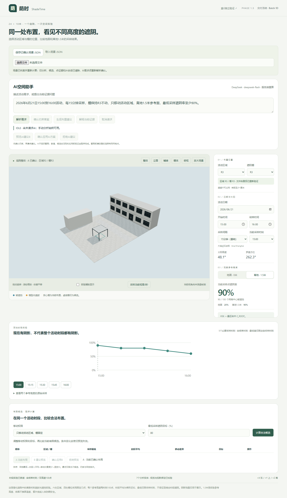

# ShadeTime Phase 1.5 · Batch 1D 验收报告

日期：2026-11-16，Asia/Shanghai。项目目录：`D:\ShadeTime`。

**裁决：GO WITH CONDITIONS。** 最小本地JSON保存/恢复已实现并通过真实浏览器与回归验证；原119项保留，新增11项，共130 PASS、0 FAIL、0 SKIP、0 CANCELLED。三条真实DeepSeek链在当前页面再次通过。证据索引、干净复现步骤、人工清单与7:20视频分镜已准备。

**条件尚未解除：负责人本轮明确“本轮暂未执行人工验收”，所以前台人工12项均NOT RUN；正式视频没有录制。** 本报告是工程候选交付，不表示满足最终录像/赛事提交门槛。后续原则上不再新增功能，转入人工核验、材料与缺陷修复。

## 1. 实际基线、分支、HEAD与时间

- 启动实查分支`feature/phase1.5-batch1c-ai`、HEAD=`5c40f63e30bc6c592bd51c619d14790955c3b18c`，工作区干净；原119项实际通过。
- 17:47:20开始核验，距本轮给定20:00功能冻结点约2小时13分。未以赶时间为由降低正确性。
- 创建本地`feature/phase1.5-batch1d-release`，没有覆盖既有分支或修改main。
- 应用代码核验点及干净复现来源：`e691826a60d7dec51f8d28c67254c781139522a9`，主题`feat: save portable confirmed scenes and restore with fresh analysis and AI invalidation`。
- 最终材料归档提交在上述应用提交之后。报告所属最终提交可用`git log -1 --format=%H -- docs/reports/final/ShadeTime-Phase1.5-Batch1D-Acceptance.md`查得；完整最终HEAD与干净状态在本轮交付JSON及聊天中另行报告，避免文档伪造自引用自身SHA。
- 本地main及本地origin/main引用仍为`7bf34be2fc86592e9283d1a7c5c0962e2d42607f`；Batch1C分支保留在5c40f63。没有推送、合并、重置、改写历史或全局Git配置。未据本地origin引用宣称重新核验远程。

## 2. 实际新增与修改文件

| 文件 | 实际变更 |
| --- | --- |
| 新增`src/domain/scene-file.js` | 版本化参数JSON序列化/严格解析，16KiB限制，复用既有合法ID、时段、布局和约束校验 |
| 修改`src/courtyard.js` | 下载已确认A、文件选择导入、先校验/计算再恢复、清缓存与引用、重置当前采样至起点 |
| 修改`src/view/ai-workflow.js` | 增加reset，用于导入后撤销旧草案/建议/审批、在途返回和客户端会话ID |
| 修改`public/courtyard.html`、`public/courtyard.css` | 最小保存/导入条与明确状态提示，沿用现有设计语言 |
| 修改`server/app.js` | 仅增scene-file模块的显式静态路由；不改AI业务、供应商或服务器数学 |
| 新增`test/scene-file.test.js` | 11项保存/非法输入/AI失效回归，全部旧测试不改 |
| 新增`scripts/check-release-browser.mjs` | 真实下载/刷新/导入/篡改拒绝/旧AI令牌拒绝的六场景浏览器验收；已有输出拒绝，不覆盖旧运行 |
| 新增`scripts/build-release-evidence.mjs` | 本地原证据摘录、Git历史和SHA256清单；不调用AI，不重造原始结果 |
| 新增`docs/evidence/final/` | 测试/复现输出、真实浏览器截图、AI回归、分类索引、文件哈希、用户人工状态 |
| 新增`docs/reports/final/` | 本报告、Manual-Acceptance.md、REPRODUCE.md、Demo-Storyboard-and-Recording.md |
| 更新README、路线、TD013、开发日志、Batch1D实施清单 | 当前范围、真实状态、复现与停止边界 |

没有新增应用依赖、AI能力、几何遮挡物、景观、材质系统、云端/账户/数据库或复杂历史。

## 3. 保存与重开一致性

保存文件使用`project: ShadeTime`、`format: shadetime-scene`、`schemaVersion: 1`，明确绑定`courtyard-v1`、`ray-box-period-v1`、`grid10-center-eps1e-4-v1`。task仅含：

- selection：已确认regionId/canopyId；正在看B预览也只保存正式A。
- period：日期、同日开始/结束、Asia/Shanghai、采样间隔。
- height：0或1.5米。
- constraints：两个对象是否可动、最低目标。

文件不含旧比例、排名、射线、分析ID、AI会话/草案/建议令牌、API Key、任意坐标或几何。无需信任文件声明的历史事实，因为这些字段根本不被接受。

导入严格检查所有层字段、版本、合法ID/布局/日期/时间/采样/高度/约束。损坏JSON、R2/R5、未知ID、非法时间、旧/未知版本、额外比例或令牌直接拒绝，不自动迁移；失败不更改当前场景。上限16KiB。

导入成功前先调用原analyzePeriod重新计算；成功后清旧候选、点证据与AI上下文，现有单调版本递增，再接入原模型。导入完全相同设置也产生新分析，不能继承旧AI草案。AI工作流通知原服务端invalidate，并丢弃客户端sessionId；下一次解析建立新会话、重新确认。

合法夜间任务可以保存恢复，但计算仍N/A。当前采样时刻恢复到开始点；不保存相机、自动恢复、撤销或历史管理。下载文件需要浏览器/用户保管，没有云同步。

## 4. 自动化与真实浏览器结果

最终运行命令：

```powershell
node --test --test-reporter=spec --test-reporter-destination=docs/evidence/final/batch1d-all-tests.spec.txt --test-reporter=tap --test-reporter-destination=docs/evidence/final/batch1d-all-tests.tap
```

| 范围 | PASS | FAIL | SKIP | CANCELLED |
| --- | ---: | ---: | ---: | ---: |
| 原Batch1C基线 | 119 | 0 | 0 | 0 |
| 新增保存/重开与AI失效 | 11 | 0 | 0 | 0 |
| 总计 | **130** | **0** | **0** | **0** |

最终运行3421.7377ms。这是Node测试耗时，不是FPS。

新增覆盖：仅导出已确认任务、无敏感/历史字段、重开后双高度真实平均/最低一致、各层历史结果/令牌拒绝、旧/未知版本提示、损坏/超大/缺失/错误项目文件、非法ID/通道/高度/约束、跨午夜/坏日期/错时区/步长、合法夜间N/A、规范化独立任务、同状态重开AI会话丢弃、迟到AI响应不复活。

真实浏览器保存六场景全部PASS（`batch1d-browser-initial.json`）：

1. B预览显示R1/R3时实际下载的仍是A的R3/R3。
2. 保存→刷新→导入，两个参考面的所有时刻、平均、最低及时间一致；analysisRuns增加，证明重新执行。
3. 改区域R6、棚R1与地面高度后导入，恢复R3/R3、1.5米及原结果。
4. 旧版、伪造比例、伪造会话、通道区域、非法时间、坏JSON、超大文件均拒绝且不改状态/分析次数。
5. 真实DeepSeek草案生成后导入同参数文件，草案/建议/证据清空；旧服务端草案确认返回STALE_CONTEXT，下一请求用sessionId=null创建新会话。
6. 导入后手动候选4合法，选择16:00仍为60%，原流程正常。

当前Batch1D页面另执行原真实AI七场景（`batch1d-ai-regression.json`）全PASS：三链、A/B拒绝与应用、引用定位与失效、非法高度、澄清、无可行方案、离线手动与取消。两批页面pageErrors均为0；AI故障回归保留预期422/离线console错误，不声称所有控制台无错误。

这些都标为AUTOMATED_BROWSER，使用本机Edge 157、外置playwright-core 1.65.1与真实WebGL/API，headless=true。没有Mock成功截图；也没有将自动化称为人工操作。

## 5. 干净复现与实际失败

以应用提交e691826的Git归档建立独立目录，起初无node_modules与.env；使用受信任外置npm执行ci，仅安装两个锁定依赖，再运行130项，全部PASS、0 FAIL/SKIP/CANCELLED，3634.4896ms。已核对Three/SunCalc版本，未复制密钥。实际结果在clean-repro.spec.txt/.tap与clean-install-tool-result.json。

有一次执行错误：依赖安装尚在后台运行时提前启动测试，缺包导致当次Node统计41项、22 PASS/19 FAIL。已保留为`batch1d-clean-repro-before-install-complete.*`，待安装完成后再运行最终成功复现；未删失败或修改断言。新的浏览器验收器另实测拒绝已有输出路径，退出1且旧JSON SHA256不变，未发起额外模型调用。

这些记录描述实际工程过程，不编造用户曾逐条指导修复。完整复现步骤见REPRODUCE.md。

## 6. 前台人工验收状态

已准备12步简短清单，涵盖冷启动、3D流畅/文字、AI等待/确认、A/B拒绝与应用、点证据、非法高度、断网恢复、保存刷新导入与旧会话。

本轮询问后，负责人真实答复：**“本轮暂未执行人工验收”。** 因此12步全部NOT RUN；流畅性、可理解性、前台人工失败恢复等没有被宣称通过。该回报登记于`docs/evidence/final/manual-status.json`与Manual-Acceptance.md，不再以自动化代填。

## 7. 竞赛证据整理

- 已建立`docs/evidence/final/README.md`、`ai-chains-index.json`、`manifest.json`和`git-history.json`。
- 三条真实AI链保留原输入、脱敏响应、请求ID、程序指标与引用、脚本确认/拒绝/应用；摘录附原文件路径、SHA256及JSON pointer，明确是DERIVED_INDEX。
- 原Batch1A/1B/1C全部证据不变，119项旧输出仍在Batch1C；本轮130项与新截图另存，不覆盖。
- 真实API、可控Mock传输、本地确定性计算、自动化浏览器、真实人工状态分类清楚。自动化按钮确认不冒充真人参与或访谈。
- 三链原始完整对话/平台导出仍未全部完成；已有指令转录和原聊天不等同最终参赛材料。没有虚构人数、使用成效、访谈或反馈。

## 8. 视频准备状态

已完成7分20秒分镜及录制前/后清单，覆盖问题定位→3D/计算→时段/双高度→解析→建议/A/B/应用→异常/保存→验证/边界。02:15–04:55共2分40秒**计划**展示真实AI协作。

**正式视频NOT RUN。** 人工验收未通过前不录正式片；没有生成动画冒充应用，没有以分镜宣称录制完成。完整原片、实际时长、音画复核、视频SHA256与最终PDF待后续材料阶段执行。

## 9. 性能与技术边界

保存恢复前后同批无头Edge整体5秒样本为238.79/239.99FPS，28 Draw Calls、17546 triangles；画布1006×560、DPR1，测试viewport1440×1000，NVIDIA RTX 5060 Laptop GPU/ANGLE D3D11。浏览器记录visible/focused，但不把无头状态等同人眼前台。

刷新/导入流程包含重载；此对照不证明长时无泄漏、前台稳定高帧或跨设备性能。Node耗时不是GPU时间。GPU时间/VRAM、跨设备/手机、人工主观卡顿：NOT RUN。旧Batch1B最重候选211.4ms超200ms目标仍保留，本轮未为提升FPS削减分析精度。

冻结审计62个文件无差异，包括原119项测试、太阳/射线/时段/布局/坐标、原视觉模型/投影/材质、供应商与AI服务端实现和依赖。唯一AI工作流改动是导入必需的reset；没有新增AI业务能力。新增文本/敏感路径检查未发现常见真实密钥格式，.env仍被Git忽略；扫描不是对所有秘密格式的绝对证明。

## 10. 运行与最终门槛

入口：`http://127.0.0.1:3000/courtyard`。既有单个服务可直接使用；未运行时在D:\ShadeTime执行`node --env-file-if-exists=.env server/index.js`。完整环境、安装、冷启动与保存文件说明见REPRODUCE.md。

未完成：前台人工验收、正式视频与最终PDF、完整原生会话导出、真实用户研究、赛事平台核验/提交。未推送GitHub、未合并main。以用户给定11月16日20:00功能冻结、17日18:00候选冻结、18日12:00内部目标/15:00截止推进后续材料，不把本轮记录当重新核验官方通知。

**本轮结束后冻结新增功能。** 可移交工程候选及材料清单；正式录像与赛事提交仍需人工门槛、材料核对及明确执行指令。现有条件支持GO WITH CONDITIONS，不支持宣布所有竞赛准备已完成。


