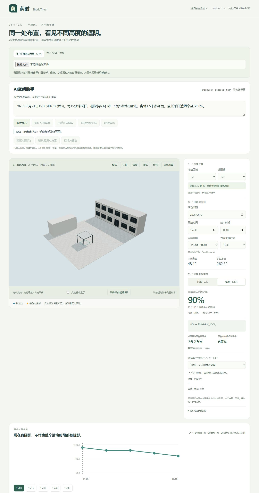

# ShadeTime Phase 1.5 Release Readiness Report

日期：2026-11-16（Asia/Shanghai）。本轮仅审计和发布冻结候选，不开发Phase 2、不修改分析核心或应用测试。

**公开候选发布：PASS。正式参赛材料就绪：BLOCKED。** 公开分支已推送并可匿名独立克隆；130项在本地、干净归档和公开克隆分别通过，实际无密钥页面、候选、保存/导入重算已验证。人工12项、正式视频、技术PDF和平台提交仍未执行。公开代码成功不能替代这些参赛门槛。

## 发布前实查

- 期望与实际起点均为`feature/phase1.5-batch1d-release`、`35dbde35f2bf5265dbc8f126bad02f2694630d26`。
- 有一处原先未提交的证据README修改：插入39行既有视频分镜副本。内容已逐字比对，其余README不变；负责人本轮明确授权保留并随发布文档提交，未覆盖或清理用户工作。
- 30笔原始提交均保留；从main到候选包含24笔新增提交，阶段1及Batch1A–1D分支没有候选之外的遗漏提交。
- 通过GitHub只读API和实际git fetch/ls-remote确认公开main为`7bf34be2fc86592e9283d1a7c5c0962e2d42607f`，候选同名远程分支尚不存在。首次Git访问有连接重置/超时，失败已记录；使用一次命令级的DNS解析结果与HTTP/1.1重试成功，没有关闭TLS验证或修改全局/系统配置。

## 安全、许可与回归

- **PASS**：扫描全部本地可达历史580对象、302份文本blob及50张图片；真实凭证/私人联系方式/敏感文件路径未发现。作者邮箱仅为GitHub公开noreply。一个静态拒绝测试占位串已核对并排除，未输出密钥。
- 图片为应用截图，已目检全部历史图像的联系表，无EXIF数据，无私人桌面或可见密钥。JSON证据只含合成庭院任务、脱敏模型回复及短时测试能力；既有服务已在归档后重启，不把旧令牌当持久授权。
- 一份npm历史记录含泛化admin工作路径，属于工程运行出处，没有私人姓名/联系方式；未发现微信私有附件路径或敏感对话。审计不读取工作.env，不对所有可能编码作绝对保证。
- 资源为程序化建筑/铺装/材质，无外部GLB、HDR或纹理缺口。锁定Three.js MIT、SunCalc BSD-2-Clause；补充THIRD_PARTY_NOTICES.md版权许可文本，不擅自决定原创代码的开源许可证。
- **PASS**：本机按lockfile重新安装两个依赖，130 PASS、0 FAIL/SKIP/CANCELLED，1609.7085ms。应用代码、依赖版本、原130项预期均未修改。
- **PASS**：从35dbde3 Git归档创建独立目录，无.env、无开发node_modules，重新npm ci安装后完整130项通过。其原始输出与全历史审计见docs/evidence/release-publication。

## 公开发布与克隆验收 — PASS

公开链接：[feature/phase1.5-batch1d-release](https://github.com/shuangliangziguangpu/shade-time/tree/feature/phase1.5-batch1d-release)。首次实际发布SHA为`28207836e2c2992397a8c511b18baa5994e8d0b0`，它在35dbde3之上仅增加发布说明、许可与审计，不改74个应用/测试/运行脚本路径。push成功后实际执行fetch、ls-remote和GitHub公开API，三者确认该SHA相同，分支跟踪正常，main仍为7bf34be。

随后只追加本轮实测记录与报告的归档提交，最终分支HEAD因此顺延；本轮完整最终SHA、远程与本地零差异在交付记录和聊天中给出。报告本身不伪造自引用其自身SHA；运行`git log -1 --format=%H -- docs/reports/final/ShadeTime-Phase1.5-Release-Readiness.md`可查本报告归档提交。最后也会将公开克隆快进到该归档提交，核对应用树与已测试提交无差异。

### 独立公开复现

**PASS**：从GitHub HTTPS地址以`--single-branch --branch feature/phase1.5-batch1d-release`重新克隆，关闭凭证助手，未使用开发目录/本地Git传输、共享node_modules、.env或旧npm缓存。克隆得到完整31笔历史（包含原30笔及发布说明提交），不是浅克隆或压缩提交。

采用全新npm缓存和空用户配置运行`npm ci --ignore-scripts`，下载两个锁定依赖；本次npm审计3个包报告0漏洞，这是供应链已知漏洞检查结果，不是绝对安全保证。安装44664ms、克隆10022ms；公开克隆完整测试为130 PASS、0 FAIL、0 SKIP、0 CANCELLED，1479.6496ms。

无需密钥，以`node server/index.js`在独立回环端口43116启动，未重复使用3000的开发服务，健康接口AI=BLOCKED。浏览器实际读取公开克隆自己的资源并通过六项：

1. 完整三维场景与七个绑定实体正确渲染，无缺失GLB/纹理/模块。
2. 1.5米平均76.25%、最低60%；地面平均5%、最低0%，双高度独立可切。
3. 缺密钥请求明确AI_UNAVAILABLE，手动实验与候选保持可用；这不是Mock模型成功，也没有发送真实供应商请求。
4. 手动合法候选与B预览可用，B显示R1/R3，正式A仍R3/R3。
5. 真实下载JSON保存A而非B，无旧比例或会话令牌。
6. 刷新后改为R6/地面，再导入刚才下载的文件，恢复R3/1.5米且重新计算为76.25%/60%，旧候选、草案和点证据清空。

上述是AUTOMATED_CUA_BROWSER_NOT_HUMAN，不计作前台人工验收。原始快照和实际截图在public-browser.json、public-clone-restored.jpg，下载文件在public-download.json。又用公开克隆自身的域模块在Node重新核对导入结果；临时43116服务已在验收后停止，归档中的短时本机会话因此失效，原3000服务未改。

本次从匿名克隆开始到浏览器验收完成记录为544787ms，约9分5秒，满足本机本次“10分钟以内复现”的目标；下载网络与机器不同不能保证同样耗时。README与REPRODUCE.md给出可执行的指定分支命令。

所有push均为候选分支普通推送，不使用force、不覆盖未知远程提交、不创建/合并PR。应用代码、全部130项测试及依赖与35dbde3一致，原Batch1A–1D提交历史保留。

### 测试汇总

| 运行位置 | PASS | FAIL | SKIP | CANCELLED | 真实耗时 |
| --- | ---: | ---: | ---: | ---: | ---: |
| 本机重装后 | 130 | 0 | 0 | 0 | 1609.7085ms |
| 35dbde3独立Git归档重装 | 130 | 0 | 0 | 0 | 1754.1813ms |
| GitHub匿名克隆、全新依赖/缓存 | 130 | 0 | 0 | 0 | 1479.6496ms |

本轮网络传输早期失败已记录；应用测试没有失败、跳过或降低断言。没有把Node耗时换算为FPS，本轮不重新做渲染性能标定。

## 人工、AI证据与材料

| 项目 | 当前实际状态 |
| --- | --- |
| 三条真实AI业务链 | PASS（既有真实API/浏览器证据）；本轮不重复付费请求。需求解析→约束确认，证据解释→引用定位，合法候选→A/B拒绝/确认→程序重算均有输入/响应/请求ID/代码提交关联 |
| 自动化Mock与确定性测试 | PASS；不冒充真实AI调用或人工验收 |
| 12项前台人工清单 | NOT RUN；沿用负责人“本轮暂未执行人工验收”的真实回报，未收到新完成记录 |
| 10分钟以内复现说明 | PASS；命令已准备且本机本次公开复现约9分5秒，不保证所有网络10分钟 |
| 5–8分钟正式视频 | NOT RUN；仅有7:20分镜，计划真实AI片段2:40，不能以计划称成片 |
| 至少2分钟真实AI协作展示 | 录像NOT RUN；实际API链已有记录，视频待人工验收后录制 |
| 30页以内技术PDF | NOT DONE；本轮未制作或伪造 |
| 完整证据索引 | PASS（文件及链路索引）；开发Prompt转录/真实API链可核查，完整原生开发会话导出仍未全部完成 |
| 竞赛平台核验及提交 | NOT RUN；未上传、未声称正式参赛提交完成 |

人工可用性、正式视频/PDF及比赛提交材料属于参赛门槛，公开代码候选成功不能代替这些门槛。后续只进行人工验收、材料与必要缺陷修复，不启动Phase 2。

## 阻断项及证据定位

| 优先级 | 项目 | 实际状态及影响 |
| --- | --- | --- |
| P0 公开候选 | 代码、历史、安全、公开克隆、130项、运行与保存重算 | PASS；无未解决的公开候选阻断 |
| P1 正式参赛 | 12项前台人工验收 | NOT RUN，阻断正式演示验收与真人可用性结论 |
| P1 正式参赛 | 5–8分钟正式视频、至少2分钟真实AI画面 | NOT RUN，仅分镜，阻断对应提交材料 |
| P1 正式参赛 | 30页以内技术PDF | NOT RUN / NOT DONE，阻断对应提交材料 |
| P1 材料真实性 | 完整原生开发会话导出、最终平台要求核对与上传 | NOT RUN（未全部完成），不能将当前摘录当作完整原生对话 |
| P2 使用边界 | 跨设备/前台长时性能与更广自然语言评估 | NOT RUN，沿用已知限制，不宣称全面性能保证 |

三条AI链的业务证据可核查：`docs/evidence/final/ai-chains-index.json`关联原始输入/模型JSON、请求ID、程序事实和确认/拒绝/应用记录；系统提示协议在`server/ai-protocol.js`及其实际历史提交中。`batch1c/ai-live-final.json`、`batch1c/browser-final.json`及`final/batch1d-ai-regression.json`保留真实API与异常路径，自动化确认不冒充真人访谈。业务链证据完整不等于全部开发原生对话已导出。

本轮发布记录：`docs/evidence/release-publication/`中的preflight、history-safety-audit、push-initial、public-clone、public-install、public-130.spec/tap、public-reproduction与public-browser。历史final/manifest记录35dbde3时的文件哈希，用户授权新增README内容后不改写旧manifest；检查旧快照需使用其当时提交，发布新增记录单独建立哈希索引。

